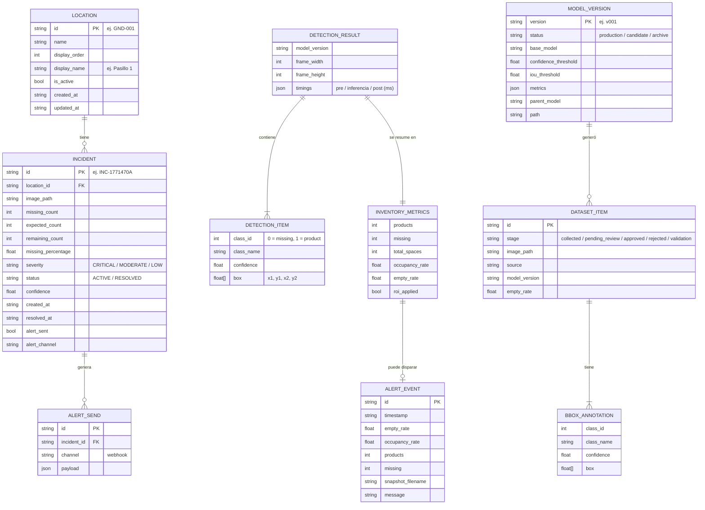

# Modelo de Datos — Computer Vision Walmart (CVW)

> **Fuentes:** esquemas Pydantic del backend (`backend/app/schemas/`), configuración (`backend/app/core/config.py`) y archivos de datos del repositorio (`data/incidents/`, `alerts/`, `models/`).
> El sistema **no usa una base de datos externa**: tal como se decidió en el Sprint 3, la información se guarda en archivos dentro del propio proyecto (JSON y JSONL).

## 1. Diagrama entidad–relación



## 2. Dónde se guarda cada entidad

| Entidad | Archivo / carpeta | Formato |
|---|---|---|
| Ubicaciones (pasillos / góndolas) | `data/incidents/locations.json` | JSON (lista) |
| Incidencias de stock | `data/incidents/incidents.jsonl` | JSONL (una línea por incidencia) |
| Envíos de alerta | `data/incidents/alert_sends.jsonl` | JSONL |
| Eventos de alerta del monitoreo en vivo | `alerts/logs/alerts.jsonl` + capturas en `alerts/images/` | JSONL + JPG |
| Imágenes analizadas con faltantes | `historica/` (imagen + `.meta.json`) | JPG + JSON |
| Muestras para reentrenamiento | `data/collected`, `data/pending_review`, `data/approved`, `data/rejected`, `data/validation` | Imágenes + etiquetas |
| Versiones del modelo | `models/production/`, `models/candidates/vNNN/`, `models/archive/` | `best.pt` + `metadata.json` |

## 3. Reglas de negocio asociadas

| Regla | Valor | Dónde |
|---|---|---|
| % de stock visible | `product ÷ (product + missing)` | `inventory_service.py` |
| Alerta del monitoreo en vivo | vacío ≥ 80 % sostenido 3 s; espera de 30 s entre alertas | `config.py` (`AlertsConfig`) |
| Severidad de incidencias | faltantes > 20 % → CRITICAL; > 10 % → MODERATE; resto → LOW | `incident_service.py` |
| Semáforo (Informe Final) | Verde 100–41 %, Amarillo 40–21 %, Rojo 20–0 % de stock visible | `semaforo_service.py` (PR #1) |
| Captura para active learning | confianza < 0,40 o vacío ≥ 70 % | `config.py` (`ActiveLearningConfig`) |
| Mínimo para reentrenar | 5 muestras aprobadas | `config.py` (`TrainingConfig`) |
| Aprobación de un modelo candidato | mAP50 ≥ 0,80 | `config.py` / `evaluator.py` |

> **Nota:** los umbrales de severidad del módulo de incidencias (por % de faltantes) son distintos de los del semáforo del Informe Final (por % de stock visible). Está pendiente unificar ambos criterios.

## 4. Ejemplo de registro (incidencia)

```json
{
  "id": "INC-1771470A",
  "location_id": "GND-TEST-2",
  "missing_count": 1,
  "expected_count": 3,
  "remaining_count": 2,
  "missing_percentage": 33.33,
  "remaining_percentage": 66.67,
  "severity": "CRITICAL",
  "status": "ACTIVE",
  "confidence": 0.88,
  "created_at": "2026-09-25T15:35:13Z",
  "alert_sent": false
}
```
